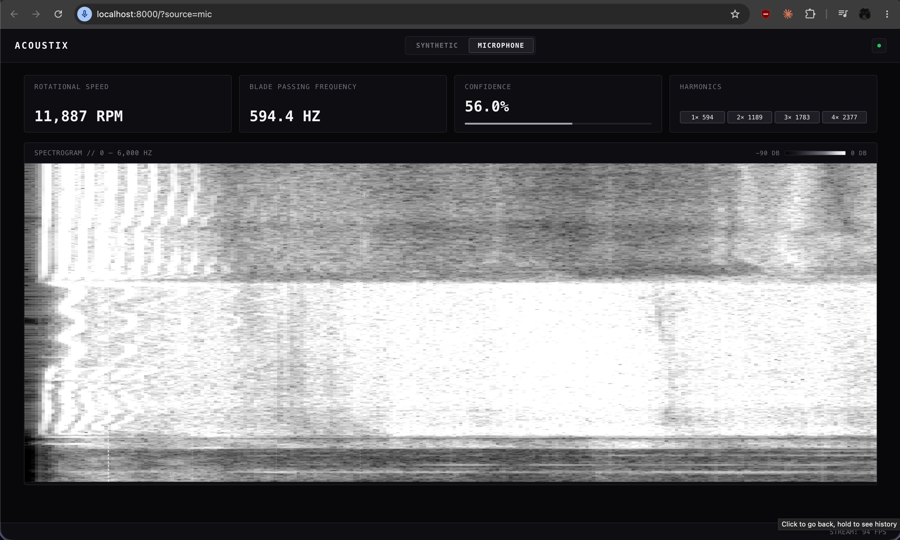

# Acoustix



Real-time acoustic signature detection and motor RPM tracking engine for FPV quadcopters.

Processes live microphone or synthetic audio streams using 4th-order Butterworth filtering, STFT analysis, and Harmonic Product Spectrum (HPS) tracking to isolate blade passing frequencies (BPF) and rotational speeds.

## Quickstart

```bash
# Install dependencies
uv sync

# Launch server & dashboard
task serve
```

Open [http://localhost:8000](http://localhost:8000) in your browser.
