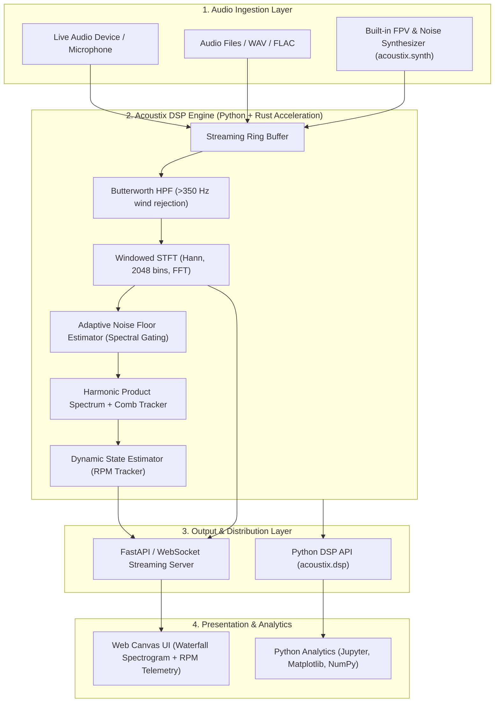

# Acoustix: High-Speed FPV Drone Acoustic Signature Detection & DSP Engine

## 1. Goal Description
Acoustix is a high-performance digital signal processing (DSP) engine and real-time acoustic monitoring system designed to detect, isolate, and track the acoustic signatures of high-speed FPV drones in noisy outdoor environments.

The system addresses four core physical and mathematical challenges:
1. **Environmental Noise Rejection**: Aggressive suppression of low-frequency wind turbulence (<350 Hz) and adaptive spectral subtraction of stationary urban/ambient acoustic noise.
2. **Time-Frequency Analysis**: Low-latency Short-Time Fourier Transform (STFT) with Hann/Blackman windowing and continuous zero-allocation ring buffering.
3. **Harmonic Motor Tracking**: Dynamic extraction of fundamental Blade Passing Frequencies (BPF: 500–1500 Hz) and corresponding harmonics to accurately reconstruct real-time motor rotational speeds (15,000–30,000 RPM) during aggressive flight maneuvers.
4. **Zero-Overhead Visualization & API Integration**: Real-time web dashboard (WebSocket-streamed waterfall spectrogram + harmonic overlays + RPM telemetry) and extensible Python APIs for offline research and batch dataset analysis.

---

## 2. System Architecture

The core codebase is implemented in **Python** (NumPy / SciPy / FastAPI), using **Rust** (via PyO3 / Maturin) as an acceleration layer for hot-loop DSP bottlenecks (SIMD STFT, zero-allocation ring buffering, real-time comb filters) as performance requirements demand.



---

## 3. Physical & Mathematical Profile of FPV Drones

| Parameter | Nominal Range | Physical / DSP Rationale |
|---|---|---|
| **Motor Rotational Speed (RPM)** | 15,000 – 30,000 RPM | Standard operating envelope for 5-inch FPV quads (4S / 6S LiPo powerplants) |
| **Shaft Frequency ($f_{\text{shaft}}$)** | 250 – 500 Hz | $f_{\text{shaft}} = \frac{\text{RPM}}{60}$ |
| **Propeller Blade Count ($B$)** | 3 blades | Standard aerodynamic profile (tri-blade props e.g., 5043, 51466) |
| **Blade Passing Frequency (BPF)** | 750 – 1500 Hz | $\text{BPF} = B \cdot f_{\text{shaft}}$ |
| **Harmonic Distribution** | 1.5–3.0 kHz, 2.25–4.5 kHz, ... | Comb structure at $k \cdot \text{BPF}$ plus inter-motor frequency modulation |
| **Sampling Rate ($F_s$)** | 44,100 / 48,000 Hz | Full audible spectrum coverage up to 22–24 kHz Nyquist limit |
| **FFT Window Size ($N$)** | 2048 samples | Frequency resolution $\Delta f \approx 23.4$ Hz at 48 kHz (optimal time-frequency compromise) |
| **Hop Size ($H$)** | 512 samples (75% overlap) | Temporal step $\approx 10.7$ ms (~93 fps frame rate) ensuring low latency during throttle bursts |

---

## 4. DSP Pipeline Specification

### 4.1 Wind & Urban Noise Rejection
- **High-Pass Pre-Filter**: 4th-order Butterworth filter with cutoff frequency $f_c = 350$ Hz. Wind turbulence and vehicle rumble concentrate predominantly below 300 Hz. Rejection slope provides $>30$ dB attenuation at $<150$ Hz without impacting the 500–1500 Hz BPF passband.
- **Adaptive Spectral Subtraction**: Continuous estimation of stationary background noise using recursive minimum statistics:
  $$\hat{N}(f, t) = \alpha \hat{N}(f, t-1) + (1-\alpha) |Y(f, t)|$$
  Spectral gating is applied to attenuate stationary urban humming and acoustic floor elevation.

### 4.2 STFT & Spectral Processing
- Pre-computed Hann window with vectorized real-to-complex FFT.
- Conversion from complex spectrum to logarithmic decibel magnitude:
  $$S(f) = 20 \log_{10} (|X(f)| + \epsilon)$$
- Pre-allocated frame buffers to minimize allocation overhead during real-time streaming.

### 4.3 Harmonic Line & RPM Tracking
- **Harmonic Product Spectrum (HPS)**: Spectral decimation and product computation across harmonic ranks ($k \in \{1, 2, 3, 4\}$) restricted to the expected BPF band $[500, 1500]$ Hz:
  $$\text{HPS}(f) = \prod_{k=1}^{K} |S(k \cdot f)|$$
- **Dynamic Comb Follower**: Harmonic candidate scoring and peak matching across adjacent frames using continuity constraints to track quadcopter motor RPM variations without losing lock during rapid throttle changes.

---

## 5. Repository & Module Structure

```
Acoustix/
├── pyproject.toml                  # Python package manifest (uv / hatchling)
├── Taskfile.yml                    # Unified automation task runner
├── docs/
│   ├── plan.md                     # Technical implementation plan
│   └── architecture.md             # Architecture invariants & ADRs
├── src/
│   └── acoustix/
│       ├── __init__.py
│       ├── dsp/
│       │   ├── __init__.py
│       │   ├── filter.py           # Butterworth HPF & bandpass pre-filters
│       │   ├── stft.py             # STFT spectrogram calculation
│       │   ├── spectral_sub.py     # Adaptive noise floor estimation
│       │   └── tracker.py          # HPS & dynamic harmonic RPM tracking
│       ├── synth/
│       │   ├── __init__.py
│       │   ├── motors.py           # 4-motor RPM simulation & harmonics
│       │   └── noise.py            # Wind turbulence & synthetic noise
│       └── server/
│           ├── __init__.py
│           ├── app.py              # WebSocket streaming & telemetry API
│           └── static/             # Canvas waterfall UI
├── rust/                           # (Optional / As needed) PyO3 acceleration
│   └── Cargo.toml
└── tests/
    ├── __init__.py
    ├── test_filter.py              # Low-frequency attenuation verification
    ├── test_tracker.py             # Harmonic tracking accuracy tests
    └── test_synth.py               # Synthetic generator tests
```

---

## 6. Verification & Quality Plan

### 6.1 Automated Unit & Integration Tests
1. **Low-Frequency Noise Attenuation Test**:
   ```bash
   uv run pytest tests/test_filter.py
   ```
   *Requirement*: Power below 300 Hz is attenuated by at least 30 dB relative to passband.

2. **Harmonic Tracking Accuracy Test**:
   ```bash
   uv run pytest tests/test_tracker.py
   ```
   *Requirement*: Estimated RPM against synthetic reference ground truth (e.g., 24,000 RPM / 1200 Hz BPF) maintains error $< 1.5\%$ ($\pm 18$ Hz).

3. **Pre-commit Automation**:
   ```bash
   task pre-commit
   ```
   *Requirement*: 0 lint errors (`ruff`), 0 test failures (`pytest`).
